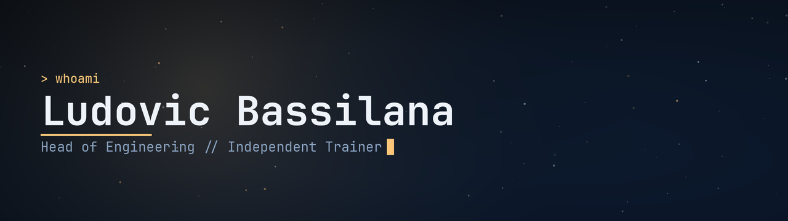
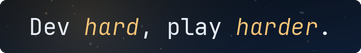

<div align="center">
<strong>🇬🇧 English</strong> &nbsp;·&nbsp; <a href="README.fr.md">🇫🇷 Français</a>
</div>
<br>

<hr>
<div align="center">

</div>
<hr>
<br>

```
$ git log --oneline --author="Anakior"

nearly 14 years growing WiziShop, on both the tech and product side
shipping Atlas Mind, an open-source MCP knowledge base
running a nonprofit CMS driven end to end over MCP
making TheEnd, a colony sim, and modeling its art in Blender
teaching developers, whatever the language
writing dark fantasy when the words come
taking RPG systems apart for the fun of it
... started as a kid, still no rollback
```

Nearly 14 years at [WiziShop](https://wizishop.com), a multi-tenant e-commerce SaaS, holding both tech and product: from lead developer and technical PM to Head of Engineering & Product Delivery. Roadmap, trade-offs, the process from idea to production, partner projects, and a team grown to nine developers.

AI in production is my common thread: first the generative AI platform inside the WiziShop admin, then [**Atlas Mind**](https://github.com/Anakior/atlas-mind), a git-native knowledge base served over MCP, and now the CMS behind [**CPG83, le Cercle des Partenaires**](https://www.cpg83.fr), which the association runs entirely from its AI assistant.

**What's next:** I'm looking for a CTO or Engineering Manager role, full remote or around Nice / Sophia Antipolis. My real job is people: growing a team, trusting it, and keeping the noise away so it can do its work.

My big personal project is **TheEnd**: a colony sim aboard humanity's last ark, where cosmic horror doesn't destroy, it possesses. The more the colony produces, the more exposed it gets, and there is no stable optimum: you manage an entropy that never stops. Turn-based tactical combat, and two first-class renderers, ASCII and sprites, plugged into the same simulation core. C# / MonoGame, a headless engine split from the client, assets modeled in Blender.

The rest of the time: training developers, writing dark fantasy, and taking RPG systems apart like an engineer.

<br>
<br>

<hr>

<div align="center">

<br>
<sub>What I reach for most. The rest, I pick up as I go.</sub>
</div>
